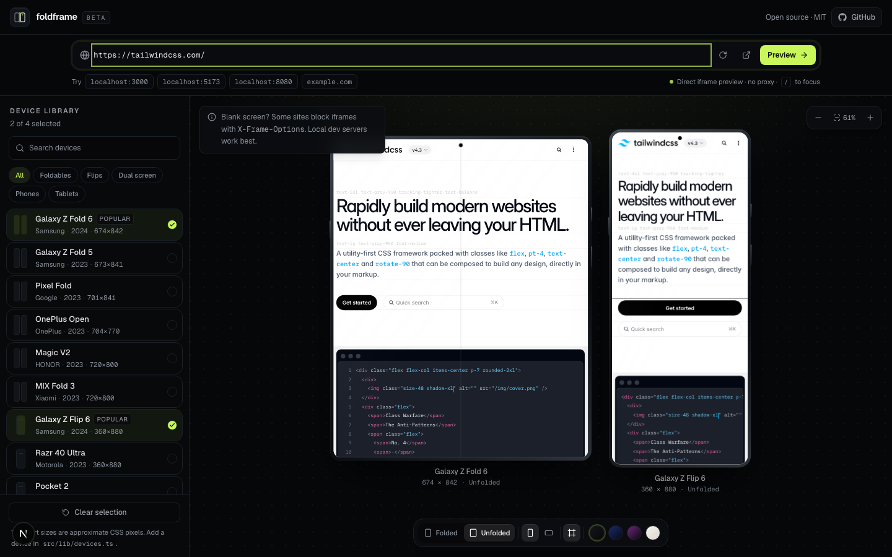

<div align="center">


# foldframe

**Preview any URL on foldables, flips and dual-screen devices.**

Paste a link or a `localhost` address and see how it actually behaves on the screens most responsive testers ignore.

[](./LICENSE)
[](https://nextjs.org)
[](./CONTRIBUTING.md)



</div>

## Why

Most device preview tools stop at iPhone and Pixel. But foldables have a cover screen **and** a main display, flips have tiny outer screens, and dual-screen devices span one viewport across a physical hinge.

`foldframe` treats those screens as first-class citizens:

- **18 presets** across foldables, flips, dual-screen phones, phones and tablets
- **Folded / unfolded modes** with realistic hinges, creases and camera cutouts
- **Compare up to 4 devices** side by side with the same URL
- **Localhost and LAN URLs** — `localhost:5173`, `192.168.1.20:3000`, `my-mac.local:8080`
- **Portrait / landscape**, zoom, device-frame toggle and four canvas themes
- **Keyboard shortcuts** and state that survives a refresh
- **No backend, no proxy, no tracking** — the URL loads directly in an iframe

## Quick start

```bash
git clone https://github.com/letyassine/foldframe.git
cd foldframe
pnpm install
pnpm dev
```

Open [http://localhost:3000](http://localhost:3000) and paste the URL of the app you are building.

### Configuration

Copy `.env.example` to `.env.local` to override the public defaults:

| Variable | Default | Used for |
| --- | --- | --- |
| `NEXT_PUBLIC_SITE_URL` | `http://localhost:3000` | Metadata, canonical URLs and Open Graph |
| `NEXT_PUBLIC_REPO_URL` | `https://github.com/letyassine/foldframe` | Header GitHub link |

### Previewing your local project

If your app runs on `http://localhost:5173`, type `localhost:5173` into the URL bar. `foldframe` adds `http://` automatically for local and private-network addresses.

> **Note:** if you deploy `foldframe` over HTTPS, browsers block `http://localhost` iframes as mixed content. Run `foldframe` locally, or expose your dev server through an HTTPS tunnel.

## Devices

| Category | Included |
| --- | --- |
| **Foldables** | Galaxy Z Fold 6, Galaxy Z Fold 5, Pixel Fold, OnePlus Open, HONOR Magic V2, Xiaomi MIX Fold 3 |
| **Flips** | Galaxy Z Flip 6, Motorola Razr 40 Ultra, Huawei Pocket 2 |
| **Dual screen** | Microsoft Surface Duo 2, LG V60 Dual Screen |
| **Phones** | iPhone 15 Pro Max, iPhone 15 Pro, Pixel 8 Pro, Galaxy S24 Ultra, Nothing Phone (2) |
| **Tablets** | iPad mini, iPad Pro 11" |

Viewport sizes are approximate logical CSS pixels (what a browser reports to the page), not physical panel resolutions. The full catalog lives in [`src/lib/devices.ts`](./src/lib/devices.ts).

## Keyboard shortcuts

| Key | Action |
| --- | --- |
| `/` | Focus the URL bar |
| `R` | Reload the preview |
| `O` | Toggle portrait / landscape |
| `F` | Toggle the device frame |

Shortcuts are ignored while typing in an input.

## How it works

- The URL is rendered in an `<iframe>` at the device's logical viewport size, so the site's own media queries respond to the correct width.
- The device body is drawn with CSS (gradients, rings, camera cutouts, hinges) and the whole frame is scaled with `transform: scale()` to fit the canvas. The iframe keeps its real viewport dimensions.
- Foldables and dual-screen devices use a single spanning iframe with a crease/gap overlay, which mirrors how these devices report a continuous viewport.
- State is stored in `localStorage`; there is no server or database.

## Limitations

- **Sites can block iframes.** Pages that send `X-Frame-Options: DENY` or a restrictive `Content-Security-Policy` will stay blank. `foldframe` deliberately does not ship an open proxy: proxying arbitrary URLs is a security and maintenance liability. Local dev servers and most embeddable sites work fine.
- **No screenshot export.** Browsers do not allow capturing pixels from a cross-origin iframe.
- **Mixed content.** An HTTPS deployment cannot iframe `http://localhost`.
- **Approximate viewports.** Device sizes change with browser zoom, display scaling and OS version.

## Adding a device

Add an entry to [`src/lib/devices.ts`](./src/lib/devices.ts):

```ts
{
  id: "my-foldable",
  name: "My Foldable",
  brand: "Acme",
  category: "foldable", // foldable | flip | dual-screen | phone | tablet
  year: 2026,
  screens: {
    folded: { label: "Cover screen", width: 360, height: 800 },
    unfolded: { label: "Main display", width: 720, height: 800 },
  },
  frame: {
    bezel: 8,
    screenRadius: 18,
    camera: "punch", // island | punch | none
    hinge: { type: "crease", axis: "vertical", size: 3 },
  },
},
```

Then run `pnpm lint && pnpm typecheck` and open a PR. Please include a source for the viewport dimensions when possible.

## Contributing

Contributions of all sizes are welcome — new devices, better frame details, accessibility fixes and docs. Read [`CONTRIBUTING.md`](./CONTRIBUTING.md) first.

```bash
pnpm dev        # start the dev server
pnpm lint       # eslint
pnpm typecheck  # tsc --noEmit
pnpm build      # production build
```

## License

[MIT](./LICENSE) © foldframe contributors
